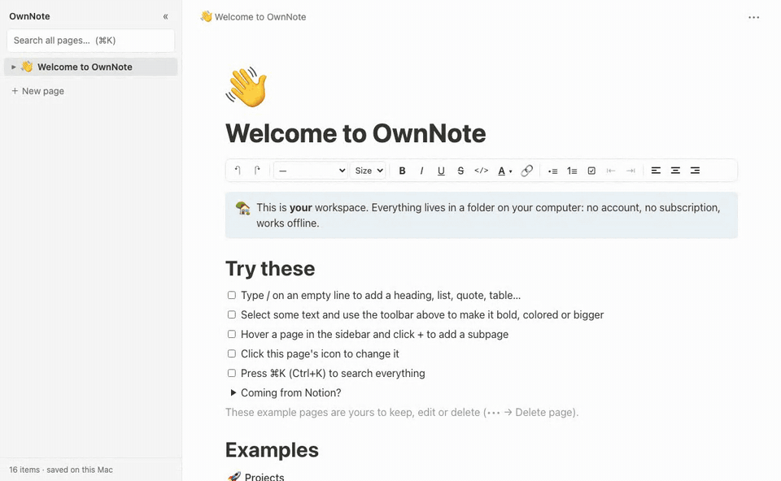
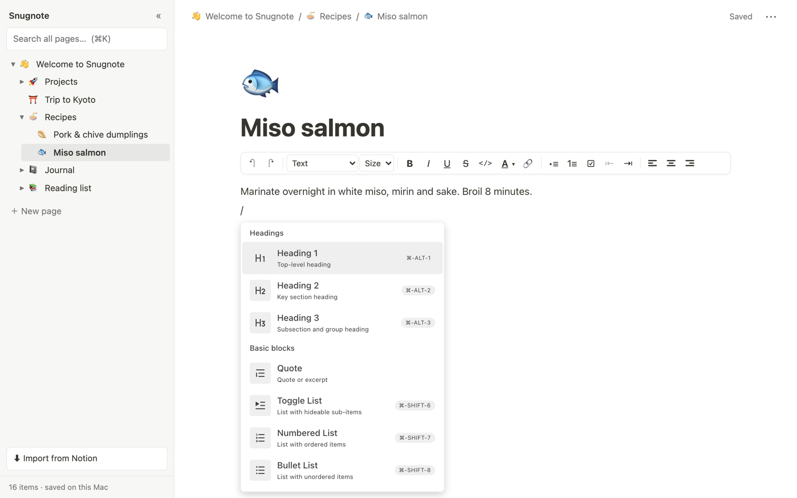
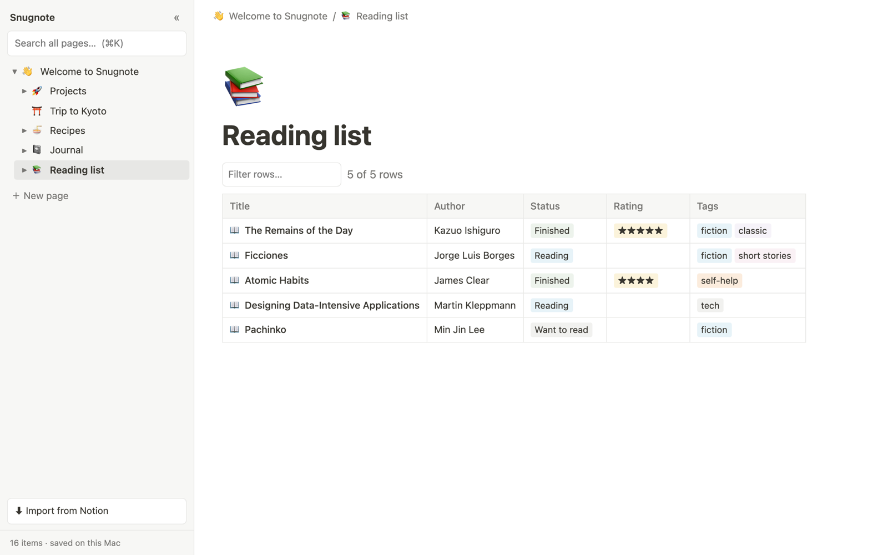
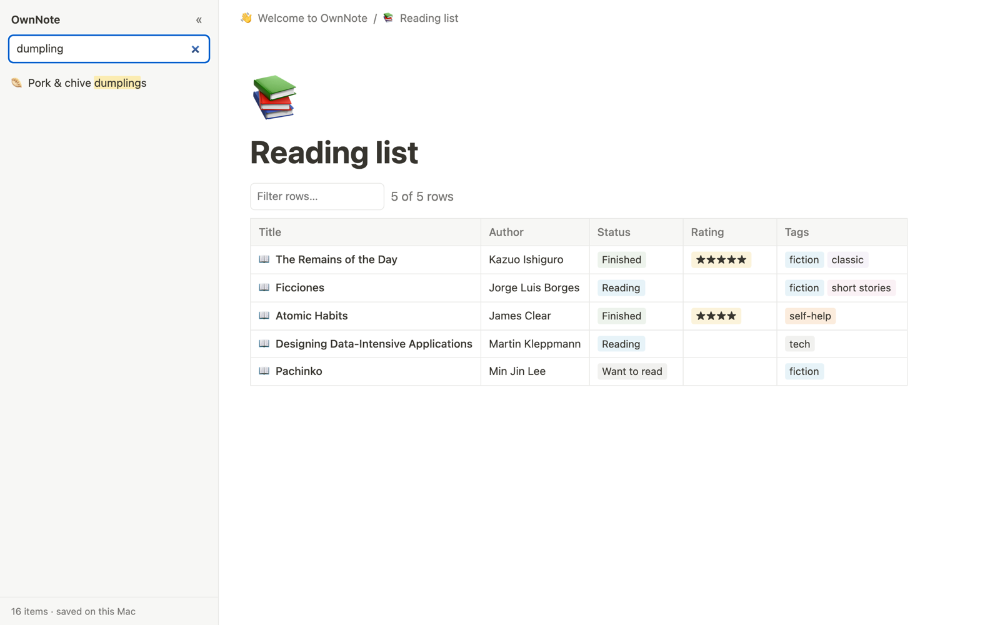
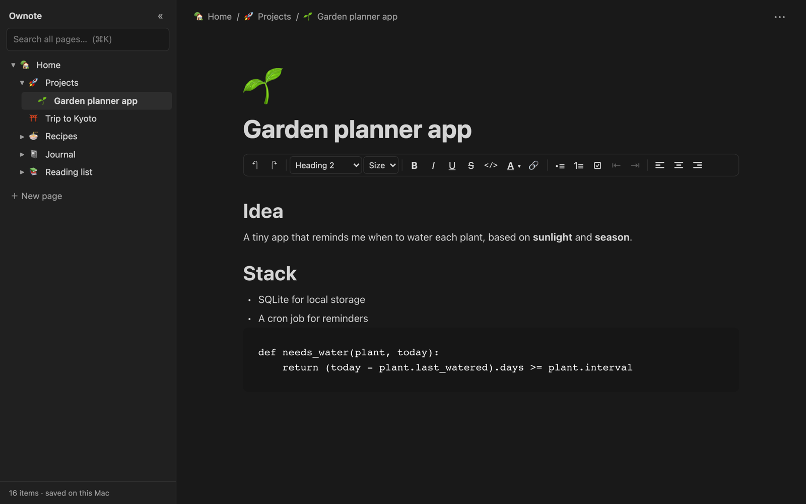
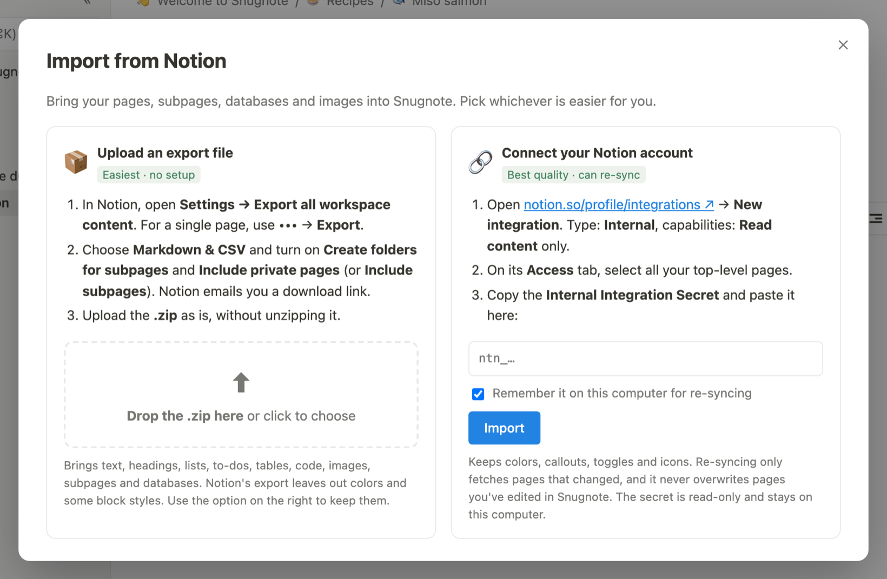

<div align="center">

# 📝 Snugnote

### Your own Notion-style workspace. Free forever, offline, and on your computer.

**Import your whole Notion workspace in one go and keep using it without a subscription.**<br>
No account. No cloud. No lock-in. Just a folder of your notes.

[](LICENSE)


[](#-contributing)

[Quick start](#-quick-start) · [Import from Notion](#-bring-your-notion-workspace) · [Features](#-features) · [FAQ](#-faq)<br>
**English** · [简体中文](README.zh-CN.md)

<br>



</div>

---

## 💡 Why Snugnote?

Notion is wonderful, but if you mostly use it as a **personal notebook**, you end up paying a monthly
subscription to read your own notes, on someone else's server, behind a login.

**Snugnote is the personal-notebook part of Notion, running on your own computer:**

- 🆓 **Free forever.** No plans, no seat limits, no upgrade prompts.
- 🔒 **Private by default.** Your notes never leave your machine. No telemetry, no account.
- ✈️ **Works offline.** On a plane, in a cabin, or when the Wi-Fi is down.
- 📦 **Your data is just files.** Back it up with Time Machine, Dropbox, a USB stick or git.
- 🚚 **Bring your Notion history.** Import every page, subpage, database and image in one go.

## 💸 Paying for Notion just to read your own notes?

Notion Plus is **$10/month** and Business is **$20/month**. In 2026 many people's discounts ended at renewal, with
bills reported going **from $96 to $240 a year**. If Notion is your *personal* notebook, you can keep every page, subpage,
database and image, and stop paying:

1. **Import** your workspace into Snugnote (one dialog, about 5 minutes of setup)
2. **Check** your important pages
3. **Cancel or downgrade** Notion

📖 **[Read the full guide: How to stop paying for Notion without losing a single note →](docs/stop-paying-for-notion.md)**

## ✨ Features

| | |
|---|---|
| ✍️ **Notion-style block editor** | `/` menu, Markdown shortcuts (`#`, `-`, `1.`, `[]`, `>`, `---`), drag-and-drop blocks, Tab to indent |
| 🧱 **All the everyday blocks** | Headings, bullets, numbered and to-do lists, toggles, quotes, callouts, code, tables, images, dividers |
| 🎨 **Rich formatting** | Bold, italic, underline, strikethrough, inline code, text and highlight colors, **font sizes**, alignment, links |
| 🚚 **One-click Notion import** | Upload Notion's export .zip, or connect your account for a full-fidelity copy you can re-sync |
| 🗂️ **Nested pages** | Unlimited subpages, a sidebar tree, breadcrumbs, emoji icons |
| 🔍 **Instant full-text search** | Search every page title and paragraph with ⌘K, with highlighted matches |
| 📊 **Databases** | Imported Notion databases show as sortable, filterable tables |
| 🖋️ **Page styles** | Default, Serif or Mono fonts, small text, full width (like Notion's ••• menu) |
| 🌗 **Light and dark mode** | Follows your system setting |
| 💾 **Autosave** | Changes are written to disk within a second. Deleted pages go to a trash folder, not into the void. |

<table>
  <tr>
    <td width="50%"><p align="center"><b>Type <code>/</code> for any block</b></p></td>
    <td width="50%"><p align="center"><b>Your Notion databases, imported</b></p></td>
  </tr>
  <tr>
    <td width="50%"><p align="center"><b>Instant search across everything</b></p></td>
    <td width="50%"><p align="center"><b>Dark mode included</b></p></td>
  </tr>
</table>

## 🚀 Quick start

You need **Python 3.8+**, which comes with macOS. Nothing else to install.

```bash
git clone https://github.com/janehwzn/snugnote.git
cd snugnote
python3 serve.py
```

Your browser opens at **http://localhost:8765** with a welcome page and a few example pages to play with.
Click **＋ New page** and start writing.

> **On a Mac?** Just double-click **`Open Snugnote.command`** in Finder.

## 🚚 Bring your Notion workspace

Click **⬇ Import from Notion** at the bottom of the sidebar and pick whichever way is easier:



### Option 1: Upload Notion's export file (easiest, no setup)

1. In Notion, open **Settings → Export all workspace content**. For a single page, use **••• → Export**.
2. Choose **Markdown & CSV**, and turn on **Create folders for subpages** and **Include private pages** (or **Include subpages**).
3. Notion emails you a download link. Drop the **.zip** into Snugnote as is, without unzipping it.

Brings over text, headings, lists, to-dos, tables, code, images, callouts, subpages and databases.
Notion's Markdown export doesn't include text colors or some block styles. Use option 2 if you want those.

### Option 2: Connect your Notion account (best quality, can re-sync)

1. Go to **[notion.so/profile/integrations](https://www.notion.so/profile/integrations)** → **New integration**.
   Choose type **Internal**, give it **Read content** only, and save.
2. On the integration's **Access** tab, select all your top-level pages. Subpages come along automatically.
3. Paste the **Internal Integration Secret** (starts with `ntn_`) into the import dialog.

This uses Notion's official API, which is free on every Notion plan, including Free. It keeps colors, callouts,
toggles and icons. A workspace with ~600 pages takes around 15–20 minutes, because Notion allows about 3 requests per second.
Tick **Remember** and you can click **Sync again** any time to pull in what changed.

**Importing again is always safe.** Pages keep their Notion IDs, so nothing gets duplicated. Only pages that changed are
updated, pages **you've edited in Snugnote are never overwritten**, and pages you deleted don't come back.

<details>
<summary>Prefer the terminal?</summary>

```bash
python3 notion_zip.py ~/Downloads/Export-xxxx.zip   # option 1
python3 backup.py                                  # option 2 (asks for the secret)
python3 backup.py --save-web-images                # save web-hosted covers/images so everything works offline
python3 export_md.py                               # export all pages to ./markdown-export/
python3 export_md.py ~/Documents/snugnote-export    # choose an output folder
```

Imports through your account save web-hosted images, covers and icons locally automatically. The last command does the same
for notes you imported with an older version.
</details>

## ⌨️ Keyboard shortcuts

| Shortcut | Action | | Shortcut | Action |
|---|---|---|---|---|
| `/` | Block menu | | `⌘B` `⌘I` `⌘U` | Bold, italic, underline |
| `#` `##` `###` + space | Headings | | `⌘Z` / `⌘⇧Z` | Undo / redo |
| `-` + space | Bullet list | | `Tab` / `⇧Tab` | Indent / outdent |
| `1.` + space | Numbered list | | `⌘K` | Search |
| `[]` + space | To-do | | `⌘S` | Save now (it autosaves anyway) |
| `>` + space | Quote | | `Enter` in the title | Jump into the page |
| `---` | Divider | | ```` ``` ```` + space | Code block |

## 🗃️ Where your data lives

```
snugnote/
├── data/                  ← all your notes (back this folder up!)
│   ├── pages/<id>.json    ← one file per page
│   ├── databases/         ← imported Notion databases
│   ├── files/             ← images and attachments
│   ├── trash/             ← deleted pages, recoverable
│   └── index.json         ← sidebar tree and titles
├── serve.py               ← the local app server (Python standard library only)
├── backup.py              ← Notion importer, via the API (Python standard library only)
├── notion_zip.py          ← Notion importer, from an export .zip (Python standard library only)
├── viewer/                ← the web app
├── starter/               ← welcome page and examples shown on first run
└── editor/                ← editor source (BlockNote + React)
```

### Keep your notes in a separate folder (recommended)

By default notes go in `snugnote/data/`. To keep them apart from the app (for example in iCloud Drive or a
backup folder), put the folder path in a file called `data-location.txt` next to `serve.py`:

```bash
echo "$HOME/Documents/My Notes/data" > data-location.txt
```

You can also set the `SNUGNOTE_DATA` environment variable. Your Notion token is then kept next to that folder
(`My Notes/token.txt`), never inside the app folder, and never served by the app.

Pages are stored in **Notion's own block JSON format**, so your data stays readable, scriptable, and
easy to convert to anything else later.

## ❓ FAQ

<details>
<summary><b>Is this affiliated with Notion?</b></summary>
<br>
No. Snugnote is an independent open-source project. It uses Notion's public API only to import your own content.
</details>

<details>
<summary><b>Notion has a free plan. Why would I switch?</b></summary>
<br>
If Notion Free works for you, that's great: it's unlimited for individuals. People switch to Snugnote when they want
files bigger than Free's 5 MB limit, page history longer than 7 days, notes that work fully offline, or simply to own
their notes as files instead of renting access to them. The <a href="docs/stop-paying-for-notion.md">guide</a> walks
through both options honestly.
</details>

<details>
<summary><b>Does anything get sent to the internet?</b></summary>
<br>
No. The app runs entirely on <code>localhost</code>. The only network traffic is the optional import, which
talks to <code>api.notion.com</code> using a token you created yourself.
</details>

<details>
<summary><b>Can I cancel my Notion subscription after importing?</b></summary>
<br>
Yes. That's the main reason Snugnote exists. Before you cancel, run the importer one last time, open Snugnote and
check your important pages. As a second copy, also use Notion's built-in
<i>Settings → Export all workspace content → Markdown & CSV</i>.
</details>

<details>
<summary><b>Can I use it on several computers?</b></summary>
<br>
Snugnote is a single-user, single-device app. You can keep the folder in iCloud Drive, Dropbox or a git repo to
move it between machines. Just don't edit on two computers at the same time.
</details>

<details>
<summary><b>Does it work on Windows or Linux?</b></summary>
<br>
It's developed and tested on macOS. The app is plain Python plus a web page, so <code>python3 serve.py</code>
should work anywhere Python runs. The <code>.command</code> launchers are Mac-only. Reports and PRs for other
platforms are welcome.
</details>

<details>
<summary><b>What doesn't work yet?</b></summary>
<br>

- **Databases are read-only.** You can view, sort and filter them and edit each row's page, but you can't add rows or change columns yet.
- **Some blocks are read-only.** Column layouts, embeds and linked database views display but can't be edited.
- **No real-time sync.** It's single-user and single-device by design.
- **Notion-only blocks.** A few blocks Notion doesn't expose through its API (some embeds, AI blocks) show as a placeholder.
</details>

## 🗺️ Roadmap

- [x] Import an entire Notion workspace (pages, databases, images)
- [x] Block editor with slash menu, Markdown shortcuts and a formatting toolbar
- [x] Subpages, icons, page styles, full-text search, dark mode
- [x] Export pages as Markdown (current page from •••, or the whole workspace with `python3 export_md.py`)
- [ ] Editable databases (add rows, edit properties, board view)
- [ ] Export to HTML
- [ ] Page covers, column layouts, @-mentions
- [ ] Packaged desktop app (no terminal needed)

Want one of these sooner? [Open an issue](../../issues) or send a PR.

## 🤝 Contributing

Contributions are very welcome. To work on the editor:

```bash
cd editor
npm install
npm run build      # outputs to viewer/editor/
```

The server and importer are dependency-free Python. Please keep it that way, so anyone can run Snugnote with just `python3`.

## 🙏 Built with

- [BlockNote](https://www.blocknotejs.org): the open-source block editor that powers the writing experience
- [React](https://react.dev) and [Mantine](https://mantine.dev)
- The [Notion API](https://developers.notion.com), for importing

## 📄 License

[MIT](LICENSE). Free for personal and commercial use.

<sub>Notion is a trademark of Notion Labs, Inc. Snugnote is not affiliated with, endorsed by, or sponsored by Notion Labs.</sub>

<div align="center">
<br>

**If Snugnote saved you a subscription, consider giving it a ⭐. It helps others find it.**

</div>
