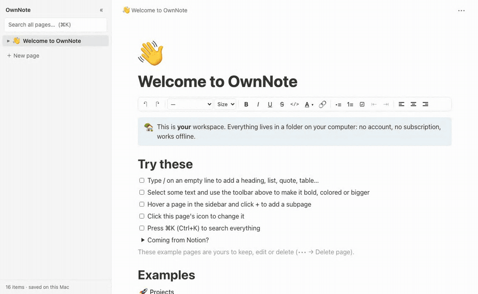

<div align="center">

# 📝 Snugnote

### 属于你自己的 Notion 式笔记本：永久免费、离线可用、数据存在你自己的电脑上

**一次性导入你的整个 Notion 工作区，不用再为 Notion 订阅付费。**<br>
无需注册，不上云，不被绑定，你的笔记就是一个普通文件夹。

[](LICENSE)


[English](README.md) · **简体中文**

<br>



</div>

---

## 💡 为什么做 Snugnote？

Notion 很好用。但如果你主要拿它当**个人笔记本**，就等于每个月花钱，才能在别人的服务器上、登录之后，看自己写的笔记。

**Snugnote 就是 Notion 里“个人笔记本”的那部分，运行在你自己的电脑上：**

- 🆓 **永久免费**：没有套餐，没有升级提示
- 🔒 **隐私优先**：笔记不离开你的电脑，没有数据收集，不需要账号
- ✈️ **离线可用**：飞机上、山里、断网时都能用
- 📦 **数据就是文件**：可以用 Time Machine、iCloud、U 盘或 git 随意备份
- 🚚 **带走你的 Notion 历史**：页面、子页面、数据库、图片一次性全部导入

## 💸 只是为了看自己的笔记，还要付 Notion 订阅费？

Notion Plus 每月 **$10**，Business 每月 **$20**。2026 年不少用户的优惠在续费时到期，有人反映年费**从 $96 涨到了 $240**。
如果 Notion 只是你的个人笔记本，你完全可以带走每一个页面、子页面、数据库和图片，然后不再付费：

1. 把工作区**导入** Snugnote（一个窗口完成，设置约 5 分钟）
2. **检查**重要页面
3. **取消或降级** Notion 订阅

📖 **[完整指南（英文）：如何不丢失任何笔记地停止为 Notion 付费 →](docs/stop-paying-for-notion.md)**

## ✨ 功能

| | |
|---|---|
| ✍️ **Notion 式块编辑器** | `/` 命令菜单、Markdown 快捷输入（`#` `-` `1.` `[]` `>` `---`）、拖拽排序、Tab 缩进 |
| 🧱 **常用块全都有** | 标题、项目符号、编号列表、待办、折叠列表、引用、标注框、代码、表格、图片、分割线 |
| 🎨 **丰富的格式** | 粗体、斜体、下划线、删除线、行内代码、文字颜色和背景色、**字号**、对齐、链接 |
| 🚚 **一键导入 Notion** | 上传 Notion 导出的 .zip，或连接账号完整同步 |
| 🗂️ **无限层级页面** | 子页面、侧边栏目录树、面包屑导航、emoji 图标 |
| 🔍 **全文搜索** | ⌘K 搜索所有标题和正文，中文也没问题 |
| 📊 **数据库** | 导入的 Notion 数据库以表格显示，可以排序和筛选 |
| 🌗 **深色模式** | 跟随系统 |
| 💾 **自动保存** | 修改一秒内写入硬盘。删除的页面进回收站，可以找回 |

## 🚀 快速开始

只需要 **Python 3.8+**（macOS 自带），不用装任何别的东西。

```bash
git clone https://github.com/janehwzn/snugnote.git
cd snugnote
python3 serve.py
```

浏览器会打开 **http://localhost:8765**，里面有一个欢迎页和几个示例页面。

> **Mac 用户**：在访达里直接双击 **`Open Snugnote.command`** 即可。

## 🚚 导入你的 Notion

点击侧边栏底部的 **⬇ Import from Notion**，两种方式任选：

**方式一：上传 Notion 导出文件（最简单，无需任何设置）**

1. 在 Notion 里打开 **设置 → 导出全部工作区内容**（单个页面：**••• → 导出**）
2. 格式选 **Markdown & CSV**，打开 **为子页面创建文件夹** 和 **包含私人页面**（或 **包含子页面**）
3. Notion 会发邮件给你下载链接，把 **.zip 直接拖进 Snugnote**（不用解压）

文字、标题、列表、待办、表格、代码、图片、标注框、子页面和数据库都会导入。Notion 的 Markdown 导出不包含文字颜色等少数样式，想要完整保留请用方式二。

**方式二：连接 Notion 账号（效果最好，可以重复同步）**

1. 打开 **[notion.so/profile/integrations](https://www.notion.so/profile/integrations)** → **New integration**，类型选 **Internal**，只勾选 **Read content**
2. 在这个 integration 的 **Access** 标签页里选中你所有的顶层页面（子页面会自动包含）
3. 把 **Internal Integration Secret**（以 `ntn_` 开头）粘贴到导入窗口里

约 600 个页面需要 15–20 分钟。勾选 **Remember** 后，之后点 **Sync again** 就能同步 Notion 里的新改动。

**可以放心重复导入**：页面保留 Notion 原来的 ID，不会重复；只更新有改动的页面，**绝不会覆盖你在 Snugnote 里改过的页面**，也不会恢复你在这里删掉的页面。

命令行用户：`python3 notion_zip.py 导出文件.zip`（方式一）或 `python3 backup.py`（方式二）。

## ❓ 常见问题

**和 Notion 官方有关系吗？** 没有。Snugnote 是独立的开源项目，只用 Notion 公开 API 导入你自己的内容。

**数据会上传吗？** 不会。应用只运行在本机 `localhost` 上，唯一的联网操作是可选的导入功能。

**导入后可以取消 Notion 订阅吗？** 可以，这正是 Snugnote 存在的意义。取消前建议最后导入一次，确认重要页面都在；另外也用 Notion 自带的“导出全部工作区内容 → Markdown & CSV”再备份一份。

**目前的限制**：数据库暂时只读（行对应的页面可以编辑）；分栏、嵌入等少数块只读；单人单设备使用。

## 📄 许可证

[MIT](LICENSE)，个人和商业用途都免费。

<sub>Notion 是 Notion Labs, Inc. 的商标。Snugnote 与 Notion Labs 没有任何关联。</sub>

<div align="center">
<br>

**如果 Snugnote 帮你省下了一份订阅费，欢迎点个 ⭐，让更多人看到它！**

</div>
